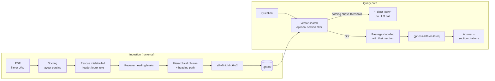

# structure-aware-rag

Q&A over PDFs that chunks along the document's **own structure** and cites the **section** each answer came from. Built with Docling, Qdrant, sentence-transformers and Groq, with no RAG framework in between.



## Text loss found while building it

Parsing the sample PDF, Docling's layout model labels the last paragraph on page 3 as a `page_footer` (confidence 0.75). Chunkers skip page furniture, so these two facts never reach the index:

> Upon receiving a complaint, the ICC will acknowledge it within 3 working days and initiate an inquiry **within 7 working days**. The inquiry will be completed **within 60** *[page break]* days.

Nothing fails. The chunk simply starts mid-sentence with "days. Both the complainant...", and no prompt or model can recover text that was never indexed.

`rescue_furniture` moves such text back into the body *before* heading recovery. Real running headers and footers are short or repeat across pages, so anything long and unrepeated is treated as prose. `stitch` then rejoins the sentence that the page break cut in two.

## Results

40 questions written for this document before any scores were seen, each with an evidence phrase that must appear word for word in a retrieved chunk. Retrieval only, no LLM. Reproduce with `uv run python evals/run.py`.

| Strategy | Chunks | hit@1 | hit@3 | hit@5 | MRR | Evidence lost |
|---|---|---|---|---|---|---|
| Fixed-size windows (96 tokens, 16 overlap) | 40 | 29 | 37 | 38 | 0.836 | 0 |
| Structure, Docling as is | 44 | 35 | 38 | 38 | 0.912 | **2** |
| Structure + rescue, content only | 44 | 36 | 40 | 40 | 0.946 | 0 |
| **Structure + rescue + heading path** | 44 | **37** | **40** | **40** | **0.963** | 0 |

What this does and doesn't show:

- Chunking by structure puts the right passage first more often than fixed windows of a similar size (37 vs 29 of 40).
- The rescue step is what takes hit@5 from 38 to 40.
- Embedding the heading path is worth **one** extra question at hit@1. On this document that is within noise. Its clear benefit is citations and filtering.
- It is one short, well-structured document with a small question set, so treat the numbers as a comparison on this PDF, not a benchmark.

## What it does

| Concern | Choice |
|---|---|
| Heading levels | `docling-hierarchical-pdf`, given the source so it can use the PDF's bookmarks. Without the source it can't reopen a URL and falls back to numbering and font style. |
| Chunking | Docling `HierarchicalChunker`. Headings become metadata and never leak into a neighbouring chunk. Chunks longer than the embedding model reads are split on sentence boundaries, keeping the heading path. |
| Embedded text | `Section > Sub-section` + paragraph |
| Citations | The LLM cites passage numbers; the code maps them to the retrieved chunks' sections. The model can't invent a section name, and unknown numbers are dropped. |
| Section filter | `--section "Leave Policy"` becomes a Qdrant payload filter on any heading in the path |
| No-answer handling | Below the similarity floor, the fallback is returned without calling the LLM. Above it, the prompt has to refuse. |

### Choosing the threshold

Similarity alone does not separate the two groups here: the weakest answerable question scores 0.250, the strongest out-of-scope one 0.302. So the floor is set at `0.2`, low enough to keep every answerable question in the set. It short-circuits 5 of the 8 out-of-scope questions, and the system prompt handles what gets through. It was picked on the same questions, so re-measure it with `search` for your own documents.

## Quickstart

Requires [uv](https://docs.astral.sh/uv/), which installs the pinned Python version.

```bash
git clone https://github.com/harshakumargh/structure-aware-rag.git
cd structure-aware-rag
uv sync
cp .env.example .env          # add your GROQ_API_KEY (only `ask` needs it)
```

```bash
uv run structure-rag ingest                              # sample PDF
uv run structure-rag ingest --source path/to/your.pdf
uv run structure-rag sections                            # indexed heading tree
uv run structure-rag search "What is the notice period?" --section "Separation & Exit"
uv run structure-rag ask "How many casual leaves am I entitled to?"
```

The first ingest downloads the layout, OCR and embedding models. They all run locally; only `ask` sends text (the question and retrieved passages) to Groq.

`ask` output (real runs, gpt-oss-20b, temperature 0):

```
Q: How soon does the ICC start an inquiry, and how long can it take?
The ICC will begin its inquiry within **7 working days** of receiving a complaint, and the
inquiry is expected to be completed within **60 days**. [1]

Sources:
  [1] AtliqAI HR Policies > Anti-Harassment & Inclusion > Complaint Resolution Process

Q: What is the notice period during probation?
The notice period during probation is 15 days. [1]

Sources:
  [1] AtliqAI HR Policies > Employment & Onboarding > Probation Period

Q: What is the policy on company cars?
I don't know. The indexed document doesn't cover this question.
```

## Project layout

```
src/structure_aware_rag/
  config.py    settings from env / .env
  parse.py     Docling parsing, furniture rescue, heading recovery
  chunking.py  heading-path chunks, stitching, oversized splitting
  embed.py     local sentence-transformers model
  store.py     Qdrant indexing, threshold search, section filter
  rag.py       context, grounded prompt, citation resolution
  cli.py       ingest | sections | search | ask
evals/         question set and retrieval comparison
tests/         offline tests (hand-built documents, fake embedder and LLM)
```

## Tests

```bash
uv run pytest
```

They run with no API key and no model download.

## Limitations

- The rescue is a heuristic. A long footer that appears on only one page (a legal notice, a footnote) would be pulled into the body.
- Dense retrieval only, so exact-keyword queries can be missed. "When is payday?" ranks the right section second because the document never says "payday".
- The index holds one document; ingesting another replaces it.
- `docling-hierarchical-pdf` depends on PyMuPDF, which is AGPL or commercially licensed. Check that before using this in a closed-source product.

Sample document: a fictional company policy from [tnahddisttud/sample-doc](https://github.com/tnahddisttud/sample-doc).
